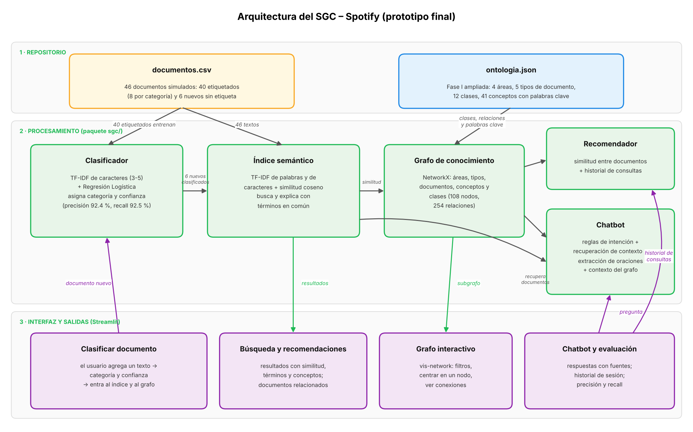

# Sistema de Gestión del Conocimiento con IA – Spotify (prototipo final)

Proyecto final de **Sistemas y tecnologías de administración del conocimiento** (Universidad Tecmilenio).

| Equipo | Profesor | Entrega |
|---|---|---|
| Jorge Emilio Quiroga López (3112182) · Adriana Matilda Cruz Rito (3096121) | Jonathan Alexis Puente Guerrero | Noviembre 2026 |

Prototipo de un sistema de gestión del conocimiento (SGC) para el área de desarrollo de software de Spotify. Integra en una sola aplicación web cuatro componentes que trabajan sobre el mismo repositorio de documentos:

| Componente | Técnica | Archivo |
|---|---|---|
| Clasificación automática | TF-IDF de caracteres + Regresión Logística (comparado con otros 4 modelos) | `sgc/clasificador.py` |
| Recomendación de documentos | Similitud coseno entre documentos + historial de consultas de la sesión | `sgc/recomendador.py` |
| Chatbot | Reglas de intención + recuperación de contexto + extracción de oraciones + contexto del grafo | `sgc/chatbot.py` |
| Grafo de conocimiento | NetworkX con la ontología de la fase I ampliada; visualización interactiva con vis-network | `sgc/grafo.py` |

El índice semántico que comparten la búsqueda, el recomendador y el chatbot está en `sgc/buscador.py`, y la integración de todo en `sgc/sistema.py`.

> Los documentos son **simulados**. Se redactaron para el proyecto con base en información pública sobre cómo trabaja Spotify; no son documentos internos reales.

**Aplicación desplegada:** https://sgc-spotify.streamlit.app

**Presentación ejecutiva (Canva):** https://www.canva.com/d/OQqudpft8OJuHmM · versión PDF en [`docs/Presentacion_ejecutiva.pdf`](docs/Presentacion_ejecutiva.pdf)

**Documento técnico:** [`docs/Documento_tecnico.pdf`](docs/Documento_tecnico.pdf)



## Resultados principales

| Qué se midió | Datos de evaluación | Resultado |
|---|---|---|
| Clasificación | 40 documentos etiquetados, validación cruzada de 5 partes | Precisión macro **92.4 %**, recall macro **92.5 %** (avance: 90.2 % y 90.0 %) |
| Búsqueda / chatbot | 15 preguntas con documentos correctos anotados, k = 3 | Recall@3 **97.8 %**, primer resultado correcto **100 %** |
| Recomendaciones por similitud | 10 documentos con sugerencias esperadas anotadas | Precisión@3 **46.7 %**, recall@3 **51.7 %**, al menos un acierto en **10 de 10** |
| Recomendaciones por historial | 3 historiales de búsqueda | Precisión@3 **100 %** |
| Grafo | ontología + 46 documentos | **108 nodos** y **254 relaciones** |

El detalle de cada prueba está en la carpeta [`evidencias/`](evidencias). Las capturas de la app desplegada (3 preguntas al chatbot y 3 recomendaciones) están en [`evidencias/capturas/`](evidencias/capturas).

## Estructura del repositorio

```
sgc-spotify/
├── app.py                      Interfaz web (Streamlit): chatbot, búsqueda, recomendaciones, clasificación, grafo y evaluación
├── requirements.txt            Dependencias
├── data/
│   ├── documentos.csv          46 documentos (40 etiquetados + 6 nuevos sin etiqueta)
│   └── ontologia.json          Ontología de la fase I ampliada para el grafo (áreas, tipos, clases, conceptos, relaciones)
├── sgc/                        Código fuente del sistema
│   ├── datos.py                Carga de datos y constantes
│   ├── clasificador.py         Componente 1 · clasificación
│   ├── buscador.py             Índice semántico (TF-IDF + similitud coseno)
│   ├── recomendador.py         Componente 2 · recomendaciones
│   ├── chatbot.py              Componente 3 · chatbot
│   ├── grafo.py                Componente 4 · grafo de conocimiento
│   ├── sistema.py              Integración de los componentes
│   └── evaluacion.py           Conjuntos de prueba y métricas
├── scripts/                    Un script por componente + evaluación
│   ├── clasificar.py  recomendar.py  chatbot.py  grafo.py
│   ├── evaluar_sistema.py      Genera toda la evidencia y las métricas
│   └── diagrama_arquitectura.py
├── ontologia/
│   ├── ontologia_sgc_spotify.owl   Ontología OWL de la fase I (se abre en Protégé)
│   └── grafo_conceptual_fase1.png  Grafo conceptual del avance
├── notebooks/
│   ├── SGC_Spotify_Final.ipynb            Recorrido del sistema final (ya ejecutado)
│   └── SGC_Spotify_Prototipo_avance.ipynb Cuaderno de la entrega de avance
├── evidencias/                 Resultados de las pruebas (markdown, imágenes, grafo HTML, metricas.json)
└── docs/
    ├── Documento_tecnico.pdf   Explicación técnica (arquitectura, componentes, despliegue, evaluación)
    ├── Presentacion_ejecutiva.pdf  Presentación ejecutiva (12 diapositivas)
    └── arquitectura.png
```

## Cómo ejecutarlo en tu computadora

Requiere Python 3.10 o más reciente.

```bash
git clone https://github.com/jequiroga0303/sgc-spotify.git
cd sgc-spotify
pip install -r requirements.txt
streamlit run app.py
```

Se abre en `http://localhost:8501`.

Para probar cada componente desde la terminal:

```bash
python scripts/clasificar.py                                  # compara modelos y clasifica los documentos nuevos
python scripts/clasificar.py "Título" "Texto del documento"   # clasifica un texto propio
python scripts/recomendar.py RI01                             # documentos relacionados con RI01
python scripts/recomendar.py --historial "pagos" "certificado vencido"
python scripts/chatbot.py                                     # conversación en la terminal
python scripts/grafo.py "concepto:Servicio de pagos"          # conexiones de un nodo
python scripts/evaluar_sistema.py                             # todas las métricas y evidencias
```

## Cómo desplegarlo en Streamlit Community Cloud

1. Sube esta carpeta a un repositorio **público** de GitHub.
2. Entra a [share.streamlit.io](https://share.streamlit.io) con tu cuenta de GitHub y elige **Create app → Deploy a public app from GitHub**.
3. Selecciona el repositorio, la rama `main` y el archivo principal `app.py`. En *Advanced settings* elige Python 3.11 o 3.12.
4. Pulsa **Deploy**. En uno o dos minutos tendrás un enlace `https://<nombre>.streamlit.app`; cópialo al inicio de este README.

## Uso rápido de la aplicación

- **Chatbot:** escribe una pregunta o pulsa uno de los ejemplos. La respuesta cita el documento del que sale y su similitud.
- **Búsqueda y recomendaciones:** busca, abre un resultado y verás los documentos relacionados. A la derecha y en la barra lateral aparecen sugerencias según tu historial.
- **Clasificar documento:** pega un texto (o usa el ejemplo) y el sistema le asigna categoría. El documento queda disponible en todos los componentes.
- **Grafo:** filtra por tipo de nodo o categoría, céntralo en un nodo y haz clic para ver sus conexiones.
- **Evaluación:** precisión, recall y casos de prueba.
