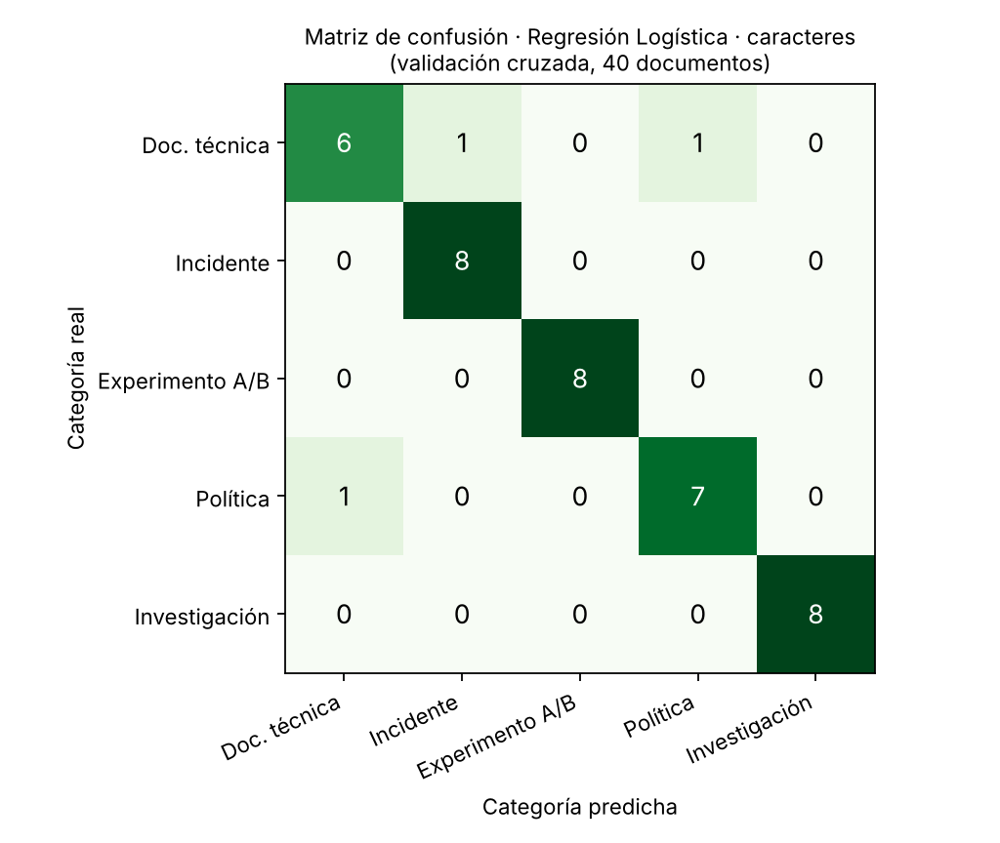

# Evidencia 1 · Clasificación automática

Datos de evaluación: los 40 documentos etiquetados (8 por categoría). Cada documento lo clasifica un modelo que no lo vio al entrenar (validación cruzada estratificada de 5 partes, semilla 42). La columna de 10 repeticiones promedia 10 particiones distintas para que el resultado no dependa del azar.

| Modelo | Exactitud (5 partes) | Exactitud (5 partes × 10 repeticiones) |
|---|---|---|
| Naive Bayes · palabras (avance) | 90.0% | 87.5% |
| Regresión Logística · palabras (avance) | 87.5% | 85.2% |
| Naive Bayes · caracteres | 92.5% | 90.8% |
| SVM lineal · caracteres | 92.5% | 93.0% |
| Regresión Logística · caracteres | 92.5% | 92.0% |

Modelo elegido: **Regresión Logística · caracteres** (da probabilidad por categoría, que se muestra como confianza).

## Precisión y recall por categoría (modelo final)

| Categoría | Precisión | Recall | F1 | Documentos |
|---|---|---|---|---|
| Documentación técnica | 85.7% | 75.0% | 80.0% | 8 |
| Reporte de incidente | 88.9% | 100.0% | 94.1% | 8 |
| Resultado de experimento A/B | 100.0% | 100.0% | 100.0% | 8 |
| Política interna | 87.5% | 87.5% | 87.5% | 8 |
| Investigación de usuarios | 100.0% | 100.0% | 100.0% | 8 |

Promedio macro: precisión 92.4%, recall 92.5%, F1 92.3%. Exactitud: 92.5%.

Modelo del avance con los mismos datos: precisión 90.2%, recall 90.0%, exactitud 90.0%.

## Errores del modelo final

| id | Título | Categoría real | El modelo dijo |
|---|---|---|---|
| DT01 | Guía de despliegue del servicio de pagos | Documentación técnica | Reporte de incidente |
| DT06 | Modelo de datos del sistema de recomendaciones | Documentación técnica | Política interna |
| PO03 | Lineamientos de uso responsable de inteligencia artificial | Política interna | Documentación técnica |

Prueba con los mismos 10 documentos reservados en el avance (25 %): 10 de 10 correctos.

## Documentos nuevos (sin etiqueta)

| id | Título | Categoría asignada | Confianza |
|---|---|---|---|
| NUEVO01 | Guía de instalación del servicio de búsqueda | Documentación técnica | 84.7% |
| NUEVO02 | Postmortem: interrupción de descargas sin conexión | Reporte de incidente | 87.5% |
| NUEVO03 | Resultado de prueba A/B: botón de mezcla aleatoria | Resultado de experimento A/B | 95.6% |
| NUEVO04 | Política de uso de datos para entrenar modelos | Política interna | 83.1% |
| NUEVO05 | Hallazgos de entrevistas con usuarios de audiolibros | Investigación de usuarios | 85.0% |
| NUEVO06 | Manual de respuesta ante alertas del servicio de cuentas | Documentación técnica | 88.7% |

