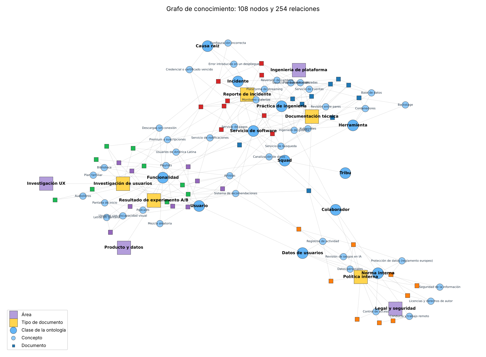

# Evidencia 4 · Grafo de conocimiento

Nodos: 108 · Relaciones: 254

| Tipo de nodo | Cantidad |
|---|---|
| Clase de la ontología | 12 |
| Tipo de documento | 5 |
| Área | 4 |
| Concepto | 41 |
| Documento | 46 |

| Relación | Cantidad |
|---|---|
| menciona | 112 |
| pertenece a | 46 |
| es un | 41 |
| similar a | 21 |
| genera | 6 |
| usa | 2 |
| depende de | 2 |
| se implementa en | 2 |
| protege | 2 |
| describe | 2 |
| se despliega en | 2 |
| forma parte de | 1 |
| es responsable de | 1 |
| desarrolla | 1 |
| aplica | 1 |
| es miembro de | 1 |
| afecta | 1 |
| tiene | 1 |
| aplica a | 1 |
| previene | 1 |
| documenta | 1 |
| se almacena en | 1 |
| analiza | 1 |
| propone | 1 |
| evalúa | 1 |
| regula | 1 |
| establece | 1 |

## Ejemplo de exploración: conexiones del concepto «Credencial o certificado vencido»

| Dirección | Relación | Nodo | Tipo |
|---|---|---|---|
| → | es un | Causa raíz | clase |
| ← | menciona | RI01 | documento |
| ← | menciona | RI05 | documento |

## Ejemplo: conexiones del documento RI02

| Dirección | Relación | Nodo | Tipo |
|---|---|---|---|
| → | pertenece a | Reporte de incidente | categoria |
| → | menciona | Servicio de autenticación | concepto |
| → | menciona | Error introducido en un despliegue | concepto |
| → | menciona | Pruebas automatizadas | concepto |
| → | menciona | Reversión de cambios | concepto |
| → | similar a (0.13) | NUEVO02 | documento |

La versión interactiva está en `grafo_conocimiento.html` y en la pestaña «Grafo» de la app.